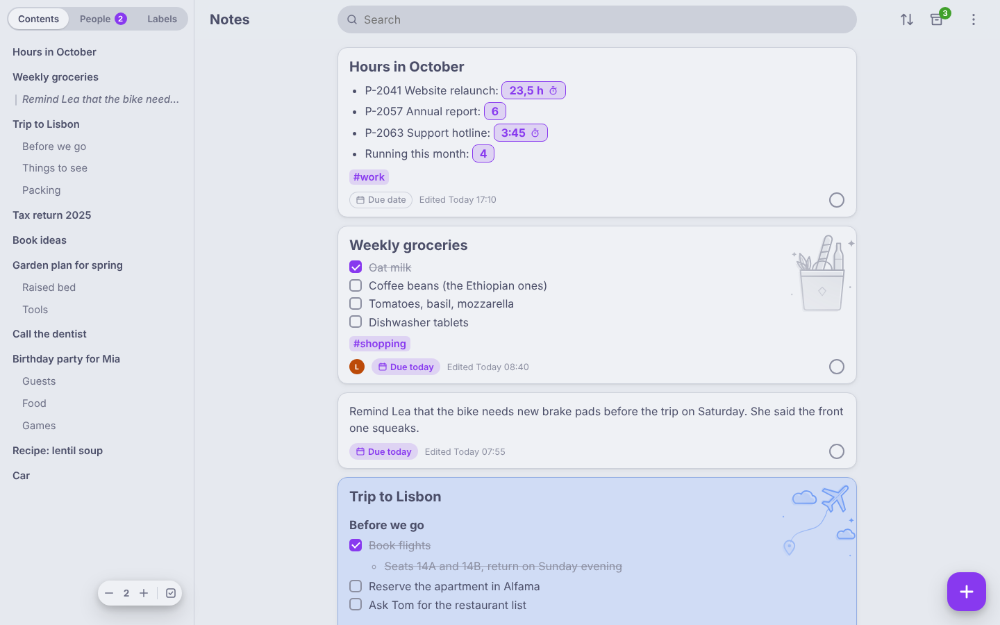
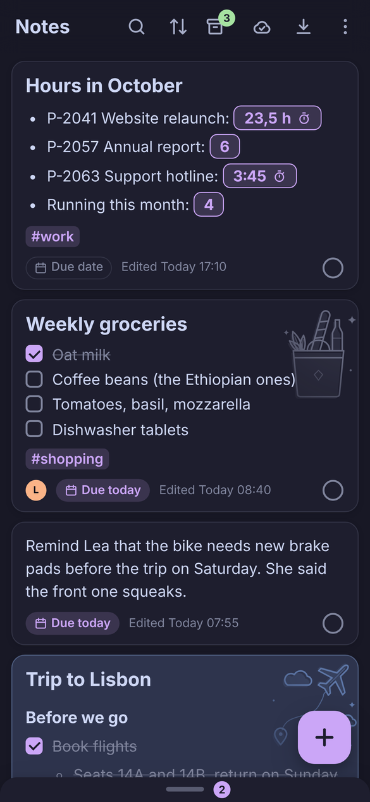
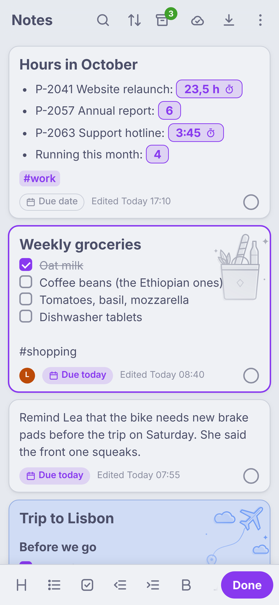

# NoteDown

<!-- toc: generated by scripts/doc-toc.js, do not edit by hand -->
- [Try the prototype](#try-the-prototype)
- [Where to look](#where-to-look)
- [License](#license)
<!-- /toc -->

A notes app for Android, iOS and the web — currently in the concept phase.

<p align="center">
  
</p>
<p align="center">
  
  &nbsp;
  
</p>
<p align="center"><sub>The prototype with its sample notes — desktop, phone in the dark theme, editing a note on the phone.</sub></p>

Every note is a Markdown section and at the same time a to-do: open or
done, with an optional due date that can remind you on the day. Open notes form the main list, done ones
move to a read-only archive. Notes live in plain Markdown files: one
private file, plus one per group of people notes are shared with;
a People tab next to the table of contents filters the list by persons or
groups, a Labels tab by the #labels written in the notes (emoji like `#😉` work too; several at once
after a long-press). A note can get a background color from a fixed palette and a built-in motif
(patterns, and drawings for birthdays, Christmas, gifts, travel, packing, a camper bus or shopping) that everyone it is shared with sees. Besides the usual sort options, notes can be put in a custom order.
The search filters the list and highlights its hits in the notes and the
table of contents; ▲ / ▼ step from hit to hit.
Notes are edited in place with an Obsidian-style live preview and a
formatting toolbar; holding the + button dictates a new note. Tasks can
also be in progress (`[/]`) or cancelled (`[-]`), picked by a long-press
on their box; a switch in the contents shows how many tasks of each
section are done. A counter
(`23,5 [-4 -1 +1 +8]`) shows its number; a tap on it pops up buttons that count up and down, e.g. for
an hour tracker; counters of time (`3:45 [-0:15 +0:15]` or `23,5 h [-1 +1]`)
can carry a stopwatch (`⏱15`) that adds the time it ran. Images and
videos from the web can be embedded; whether they load by themselves,
after a tap or never, and whether links open, ask first or stay text, is
set per device — for all notes and per circle — so no one else's note
makes a device contact another host. A
long-press on a note starts multi-select to close, copy, share, merge,
make permanent (notes of lasting value that can't be closed) or delete
several notes at once, or to clear ticked tasks out of a list into the
archive (with a way back into the note). Deleted notes wait in a trash for 30 days —
also shared notes someone else deleted, which can be restored for
everyone or kept as one's own; a long-press on a heading (in a note or in the table of
contents) selects its section, which can be moved together into a new note.
The Export button in the top bar saves the current view, or all files as a ZIP for a local
backup, as Markdown — with or without a table of contents and the hidden
metadata; the selection exports single notes or sections the same way.

Notes stay on the device and work offline. Sync between phone, tablet
and the web app, and sharing single notes with other people, run through
an end-to-end encrypted server: it only ever stores encrypted files.
There are no accounts — devices and contacts are connected by scanning a
QR code.

Right now this repository holds the requirements and a clickable
prototype that works out what NoteDown does and how it is operated on
desktop, tablet and phone. The prototype is turning into the real app:
Android (a Capacitor shell in `mobile/`) and the web come first, with a
Python sync server in `server/`. End-to-end encrypted sync works: turn
it on with the cloud button (Sync & sharing), link further devices by scanning a QR
code (or with the recovery key), add contacts by their code or an
invitation link (verify the latter later by a safety code), and share notes with them from multi-select → Share.
Where the server's owner has switched on version history for an
identity, Sync & sharing → Version history brings back an older state
of the notes (kept for 30 days) and "Back up now" keeps the current state;
"Your identity" shows the ID to tell the owner.
The server's owner has an admin page at `/admin/` (signed in with their
own linked device): what the server stores, the identities (searchable
by ID) with their devices and files, the most people a group can have
(for the server and per identity), a storage limit and the version
history per identity, blocking or deleting an identity, news posts for everyone
using the server (they show as **News** at the top of the people
overview), and backup / restore — `app/admin/?sample` shows it with
sample data. Notes from Google Keep come in through `/import/`: choose
the Google Takeout ZIP, check the preview of every note, import the ones
you want (`app/import/?sample` shows it with sample data). Your sync
data is deleted with the recovery key under Sync & sharing or on
`/delete/` (`app/delete/?sample`).
Settings → About shows the version, the open-source licenses of
everything the app ships, and links to the privacy policy (`/privacy/`)
and the terms of use (`/terms/`), which name whoever runs the server.

## Try the prototype

No install, no build — serve the repo:

```bash
python3 scripts/serve.py
```

It prints the addresses: <http://localhost:8000/app/> on this computer,
and `http://<computer-ip>:8000/app/` for a phone in the same network. Resize the window to see the tablet
and phone layouts; ⋮ → Settings switches the theme. The prototype keeps real notes
and starts with a few welcome notes; add `?sample` to the address to replace
them with the sample notes. Dictation needs `localhost` or https; add
`?dictation=demo` to try it without a microphone.

## Where to look

- [`docs/requirements.md`](docs/requirements.md) — the decided scope.
- [`docs/interaction-concept.md`](docs/interaction-concept.md) — how the
  app is operated across devices.
- [`docs/file-format.md`](docs/file-format.md) — the Markdown file.
- [`docs/sync-and-sharing.md`](docs/sync-and-sharing.md) — sync, sharing
  and encryption.
- [`docs/server-api.md`](docs/server-api.md) — the protocol between app
  and server.
- [`docs/operations.md`](docs/operations.md) — the live test setup:
  hosting, deployment, one-time setup.
- [`FEATURE_BACKLOG.md`](FEATURE_BACKLOG.md) — ideas not yet decided.

Themes use the [Catppuccin](https://catppuccin.com) palette (MIT);
Markdown rendering uses [marked](https://github.com/markedjs/marked),
editing [CodeMirror](https://codemirror.net) (both MIT), and the Android
app [Capacitor](https://capacitorjs.com) (MIT).
Every third-party component with its license is listed in the app under
Settings → About → Open-source licenses.

## License

NoteDown is free software under the [GNU Affero General Public License,
version 3 or later](LICENSE). Contributions: see
[`CONTRIBUTING.md`](CONTRIBUTING.md).
